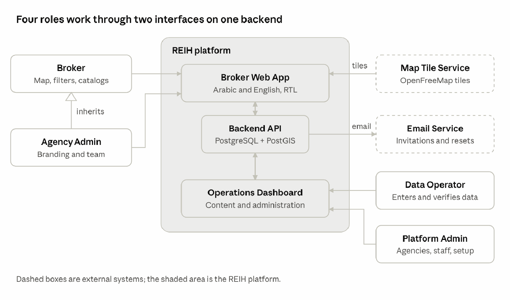
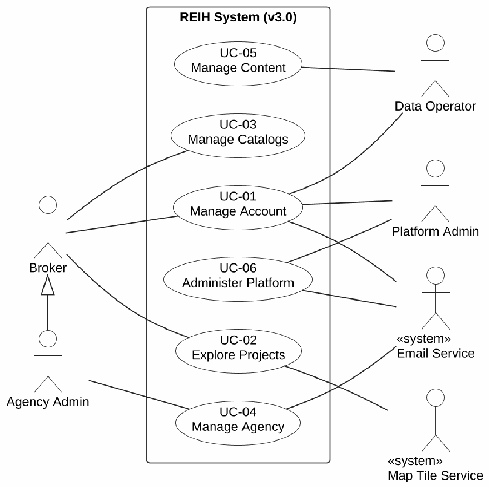

<!-- Converted from docs/srs/REIH_SRS_v3.1.pdf (48 pages). Page headers and footers are omitted. -->

# REIH SRS v3.1

Oct 27, 2026 · Deaa Al-Deen Al-Soud

REIH SRS v3.1 is the baseline of the graduation project: the analysis ends with it, and the design and the code start from it. It covers the GenieMap core for developers' off-plan projects in the UAE that one student can build between October 2026 and January 2027. It defines 78 functional requirements (64 Must, 14 Should), 17 non-functional requirements, and 16 business rules, organized into 6 high-level and 50 detailed use cases. Four roles use the system (Broker, Agency Admin, Data Operator, Platform Admin), with two external services (map tiles and email). It covers 31 of the 32 requirements observed in GenieMap's interface; only places nearby is deferred.

## 1. Introduction

This SRS is the baseline for building REIH v1.0 as a graduation project between 1 October 2026 and 31 January 2027. It keeps the features GenieMap is known to offer, plus the minimum needed to run them.

### 1.1 Document control

| Item | Value |
| --- | --- |
| Product | REIH (Real Estate Intelligence Hub) |
| Document | Software Requirements Specification |
| Version | 3.1 (graduation scope, baseline) |
| Date | 27 October 2026 |
| Prepared by | Deaa Al-Deen Al-Soud |
| Supervisor | Dr. Modar Kewan |
| University | Syrian Private University (SPU) |
| Status | Baseline: final version of the analysis, submitted to the supervisor for approval. Later changes are made only through a new version recorded in Section 1.7. |
| Relation to v2.3 | Replaces SRS v2.3 as the baseline of the graduation project. v2.3 remains the long-term product vision. |

### 1.2 Purpose

This document defines what REIH v1.0 must do and how well it must do it. It is the reference for the design, the code, the tests, and the analysis chapter of the graduation report. Every requirement has a unique ID that the use cases, test cases, and traceability matrix refer to. Its readers are the supervisor, the developer, and the examiners.

### 1.3 Product scope

REIH is a business-to-business web platform for real estate brokers and agencies in the United Arab Emirates. Brokers explore developers' off-plan projects on an interactive map, filter them, and read project and unit details with payment plans. They reveal developer sales contacts and turn their selection into a branded PDF catalog for a client. A data team keeps the information current, and a platform administrator manages agencies and settings. REIH is an information and marketing tool only: no purchase, reservation, or payment happens in it. It covers the primary market only, meaning projects sold by their developers; resale and rental listings are excluded (Section 9).

v1.0 includes:

- Accounts created by invitation, with four roles: Broker, Agency Admin, Data Operator, and Platform Admin.
- Interactive map, search, and filters.
- Project card with information, units, amenities, payment plans, documents, and seller details.
- Sales contact reveal with logging.
- Branded PDF catalogs in Arabic and English.
- Agency branding and team management.
- Content management and data verification for the data team.
- Platform administration: agencies, staff, reference data, exchange rates, and settings.

Section 9 lists what v1.0 excludes.

### 1.4 Sources of the requirements

Every functional requirement names its source, so the scope stays close to what GenieMap is known to offer. GenieMap is a closed platform, so its features are known only from the sources below. No data, text, images, or brand elements are taken from it (BR-15).

| Tag | Source | Meaning |
| --- | --- | --- |
| V | Genie_Map_SRS_AR v1.0: analysis of a walkthrough video of GenieMap's interface | Feature shown in the video; the video requirement number is given |
| V~ | Same source | Feature partly shown or marked "to confirm"; REIH defines its behavior |
| P | GenieMap's public website | Feature that GenieMap states publicly |
| Proto | PROJECT_ANALYSIS.md: analysis of the team's "UAE Property Map" prototype | Feature present in the prototype's interface |
| S | Supporting | Needed for the system to work: accounts, data entry, administration |
| R | REIH addition | Small addition that makes the data more trustworthy |

### 1.5 Definitions and abbreviations

| Term | Meaning |
| --- | --- |
| Broker | Licensed real estate agent who works for an agency and sells property to clients |
| Agency | Real estate brokerage company that uses REIH |
| Developer | Company that builds and sells real estate projects. In REIH a developer is data, not a user. |
| Off-plan project | Project sold by its developer before or during construction. v1.0 shows developers' projects in three stages: upcoming (announced, not launched yet), under construction (sold off-plan), and ready (completed, with units still sold by the developer). |
| Community | Named district inside an emirate, such as Dubai Marina |
| Handover | Delivery of finished units to buyers, expressed as a quarter and a year |
| Payment plan | Schedule of payments for a unit, made of milestones whose percentages total 100% |
| Sales contact | Developer sales manager whose phone number brokers can reveal |
| Catalog | Branded PDF of selected projects and units that a broker prepares for a client |
| Verification | Confirmation of a project's prices and availability, recorded with a date and a source |
| Stale data | Data whose last verification is older than the configured threshold |
| BRN / ORN | Broker Registration Number / Office Registration Number issued by the regulator |
| AED | United Arab Emirates dirham, the base currency |
| RTL | Right-to-left layout used for Arabic |
| Must / Should | Must: required for the January 2027 delivery. Should: planned, and delivered if time allows (MoSCoW). |

### 1.6 References

1. Genie_Map_SRS_AR.docx, version 1.0, 13 October 2026: requirements observed in a GenieMap interface video (32 functional requirements, 6 use cases, 8 non-functional requirements).
2. PROJECT_ANALYSIS.md, 16 October 2026: analysis of the "UAE Property Map" prototype.
3. REIH SRS v2.3: full-product specification (225 functional requirements, 50 use cases).
4. real_estate_b2b_platform_SRS_AR.docx: initial Arabic SRS of the B2B platform.
5. GenieMap, "Unified service for real estate agencies worldwide", promo.geniemap.net, accessed October 2026.
6. ISO/IEC/IEEE 29148:2018, Systems and software engineering: Life cycle processes, Requirements engineering.

### 1.7 Revision history

| Version | Date | Change | Author |
| --- | --- | --- | --- |
| 2.2 | October 2026 | Full-product SRS | Deaa Al-Deen Al-Soud |
| 2.3 | October 2026 | Full-product SRS revised: 225 functional requirements, 36 non-functional requirements, 50 use cases, 11 human actors | Deaa Al-Deen Al-Soud |
| 3.0 | 21 October 2026 | Graduation scope: 78 functional requirements, 17 non-functional requirements, 16 business rules, 6 high-level use cases; actors corrected (Section 2.2) | Deaa Al-Deen Al-Soud |
| 3.1 | 27 October 2026 | Audit and baseline. Off-plan, primary-market scope stated. Gaps closed: resending staff and first-admin invitations, session timeout, password length, upload limits, time zone, catalog items whose project is unpublished, and backups outside the application. Exact table list (Section 8). Decisions D-01 to D-03 taken (Section 10.3). The counts of requirements, rules, and use cases are unchanged. | Deaa Al-Deen Al-Soud |

## 2. Overall description

REIH v1.0 is a new web system. Four roles use it through two interfaces that share one backend, and it replaces the team's single-page prototype.

### 2.1 Product perspective

REIH v1.0 replaces the "UAE Property Map" prototype. The prototype is a single page with six hard-coded projects whose project tabs are static images. It is kept only as a reference for the user experience and the filter values; none of its code, data, or files is reused.

The system has two web interfaces on one backend:

- **Broker Web App**, used by Brokers and Agency Admins: the map, search and filters, project cards, catalogs, profile, and agency settings.
- **Operations Dashboard**, used by Data Operators and the Platform Admin: content management, data verification, and platform administration.

Context diagram · 4 roles, 2 interfaces, 2 external systems

Brokers and Agency Admins use the Broker Web App; Data Operators and the Platform Admin use the Operations Dashboard. The backend sends emails through the email service, and browsers load map tiles directly from the tile service.

### 2.2 Actors

An actor is a role outside the system that interacts with it. v1.0 has four human roles, one abstract parent role, and two external systems.

| Actor | Type | Who | Use cases |
| --- | --- | --- | --- |
| Registered User | Abstract; parent of the four human roles | Not a separate person or role in the system: an abstract actor that stands for anyone with an account, so the account use cases are modelled once for the four roles. | UC-01 |
| Broker | Primary | Agent of an agency who finds projects, builds catalogs, and presents them to clients | UC-01, UC-02, UC-03 |
| Agency Admin | Primary; specializes Broker | Manager of an agency. Does everything a Broker does, and manages the branding and the team. | UC-01 to UC-04 |
| Data Operator | Primary | Staff member of the company that runs REIH, in its data team, who enters, publishes, and verifies data | UC-01, UC-05 |
| Platform Admin | Primary | Staff member of the company that runs REIH who manages agencies, staff, reference data, and settings | UC-01, UC-06 |
| Map Tile Service | Secondary; external system | Supplies the base map tiles (OpenFreeMap) | UC-02 |
| Email Service | Secondary; external system | Delivers invitation and password-reset emails | UC-01, UC-04, UC-06 |

The two staff roles are separate: the Platform Admin cannot edit content, and a Data Operator cannot manage agencies or staff. One person may hold one account of each role.

Developer sales managers are not actors. They are contacts stored as data, and brokers call them outside the platform.

v2.3 used the abstract actors Authenticated User and Organization Member for logging in, resetting a password, and accepting an invitation. A person doing these is not authenticated or a member yet, so v1.0 uses Registered User: the account exists from the moment of the invitation.

**Actors of v2.3 that v1.0 removes or merges**

| v2.3 actor | Decision | Reason |
| --- | --- | --- |
| Client | Removed | Not a platform user: no account and no login. The broker sends the PDF outside the system, and shared catalog links are out of scope. Watching the broker's screen in a meeting is not an interaction with the system. |
| Visitor | Removed | There is no public access-request form. The Platform Admin creates each agency after an agreement made outside the system. |
| Agency Owner | Merged into Agency Admin | The only differences were the branding and viewing the subscription, and subscriptions are out of scope. |
| Developer Admin, Developer Editor, Developer Viewer | Removed | There is no developer portal. Data Operators enter developer data, and the GenieMap interface shows no developer users. |
| Support / Sales | Merged into Platform Admin | Its remaining task, onboarding agencies, moves to the Platform Admin. Subscriptions, trials, and privacy requests are out of scope. |
| Super Admin | Renamed Platform Admin | Same role, without subscriptions and plans. |
| Scheduler | Removed | No time-triggered use case remains, and it was an internal component, not an outside actor. |
| Exchange-rate, places, and language model services | Removed | The Platform Admin enters exchange rates; nearby places and the AI assistant are future work. |

### 2.3 Product functions

- **Explore:** map with clustered project markers, search with suggestions, and filters by location, developer, price, handover, stage, and unit.
- **Inspect:** project card with information, units, amenities, payment plans, documents, and seller details, and the data freshness of every project.
- **Contact:** reveal a developer sales manager's number, with a log of every reveal.
- **Sell:** build a catalog of projects and units and generate a branded PDF in Arabic or English; present it full screen in an online meeting (Should).
- **Manage the agency:** branding and team.
- **Maintain the data:** developers, sales contacts, areas, projects, media, payment plans, units, publication, and verification.
- **Administer:** agencies, staff, reference data, exchange rates, and settings.

### 2.4 Operating environment

- **Browsers:** the latest two versions of Chrome, Edge, Firefox, and Safari, on desktop (1280 px and wider) and tablet (768 px and wider). Phones are supported for the map and the project card.
- **Server:** one Linux server (4 vCPU, 8 GB RAM, 100 GB disk) running Docker Compose, reachable over HTTPS.
- **Languages:** Arabic (right to left) and English (left to right) in the interface and in catalogs.
- **Market:** United Arab Emirates, with AED as the base currency.

### 2.5 Design and implementation constraints

- **Technology (decided):** Next.js with TypeScript for the web interfaces; NestJS as a modular monolith for the backend; PostgreSQL 16 with PostGIS 3.4 and pg_trgm; Drizzle ORM; Redis with BullMQ for background jobs; Playwright (headless Chromium) for PDFs; MapLibre GL JS with OpenFreeMap tiles; Caddy as the HTTPS reverse proxy; Docker Compose.
- **Team and time:** one developer, from 1 October 2026 to 31 January 2027, supervised by Dr. Modar Kewan.
- **Content and licensing:** only licensed or self-produced data and media. Nothing is taken from GenieMap or other platforms, and no prototype asset (project images, PDFs, videos, statistics images, developer descriptions) is used without a written license.
- **Prototype security:** the token hard-coded in the prototype's chat.php must be revoked, and chat.php and gpu.php are neither reused nor deployed.
- **Secrets:** no keys or passwords in the code; configuration comes from environment variables (NFR-10).
- **First account:** the first Platform Admin is created by a command-line seed at installation.

### 2.6 Assumptions and dependencies

- Data Operators enter data by hand from licensed sources, such as developers' price lists shared with permission.
- The demonstration uses sample data created by the team (decision D-02 in Section 10).
- The Platform Admin onboards agencies after an agreement made outside the system; there is no online payment.
- A transactional email account is available for invitations and password resets.
- OpenFreeMap tiles stay available; otherwise the map provider is replaced behind the map layer.
- The UAE is the only market, and AED is the base currency.

## 3. External interface requirements

REIH offers people two web interfaces and depends on six software interfaces. All traffic uses HTTPS.

### 3.1 User interfaces

Rules for every screen:

- Every screen exists in Arabic (right to left) and English (left to right). Switching the language keeps the current screen.
- Layouts are designed for desktop first and work on tablets. The map explorer and the project card also work on phones.
- Loading, empty, and error states are always visible, and a failed load offers a retry.
- A converted price always shows the AED price beside it.

| Screen | Interface | Users | Main contents | Requirements |
| --- | --- | --- | --- | --- |
| Log in, activate account, reset password | Both | All roles | Email, password, terms acceptance | FR-ACC-01 to FR-ACC-03 |
| Map explorer | Broker Web App | Broker, Agency Admin | Map, search bar, filter groups, active filters, results list (Should) | FR-MAP, FR-FLT |
| Project panel | Broker Web App | Broker, Agency Admin | Gallery and header; tabs Information, Units, Amenities, Payment Plans, Documents & Videos, Seller | FR-PRJ, FR-CNT |
| Units list and unit card | Broker Web App | Broker, Agency Admin | Groups by layout, sortable list, unit card with actions | FR-UNT |
| Catalog builder | Broker Web App | Broker, Agency Admin | Items and their order, notes, settings, generation status | FR-CAT-01 to FR-CAT-06 |
| Catalog library | Broker Web App | Broker, Agency Admin | The user's catalogs with their versions and actions | FR-CAT-07 |
| Presentation mode (Should) | Broker Web App | Broker, Agency Admin | Full-screen branded view of a catalog | FR-CAT-08 |
| Profile and preferences | Both | All roles | Profile fields, language, currency, area unit, password change | FR-ACC-03, FR-ACC-05, FR-ACC-06 |
| Agency settings | Broker Web App | Agency Admin | Branding with a preview; members and invitations | FR-AGY |
| Content lists and forms | Operations Dashboard | Data Operator | Developers, sales contacts, areas, projects, media, payment plans, units | FR-DAT-01 to FR-DAT-09 |
| Needs verification | Operations Dashboard | Data Operator | Projects sorted by oldest verification, with a verify action | FR-DAT-10 |
| Units import (Should) | Operations Dashboard | Data Operator | Template download, upload, validation report | FR-DAT-12 |
| Agencies | Operations Dashboard | Platform Admin | Agency list, details, suspension, first-admin invitation | FR-ADM-01, FR-ADM-02 |
| Staff | Operations Dashboard | Platform Admin | Staff accounts and roles | FR-ADM-03 |
| Reference data | Operations Dashboard | Platform Admin | Dictionaries and catalog themes (Should) | FR-ADM-04, FR-CAT-09 |
| Currencies and settings | Operations Dashboard | Platform Admin | Display currencies, exchange rates, thresholds and limits | FR-ADM-05, FR-ADM-06 |
| Reveal log, audit log, overview (Should) | Operations Dashboard | Platform Admin | Logs with filters; platform counts | FR-ADM-07, FR-ADM-08, FR-ADM-10 |

### 3.2 Software interfaces

| Interface | Used for | Notes |
| --- | --- | --- |
| Map tiles: OpenFreeMap, drawn with MapLibre GL JS | Base map | Loaded over HTTPS by the browser, and by the PDF worker for catalog maps, with the attribution shown on both; the provider can be replaced behind the map layer |
| Email: SMTP of a transactional email provider | Invitations and password resets | SMTP settings come from environment variables; Mailpit catches all mail in development; the sender domain uses SPF and DKIM (D-03) |
| Database: PostgreSQL 16 with PostGIS 3.4 and pg_trgm | All data, spatial queries, and text search | Reached only by the backend |
| File storage: local disk (a Docker volume) | Images, documents, and generated PDFs | Files are served through short-lived signed links; S3-compatible storage can replace the disk later |
| PDF rendering: Playwright with headless Chromium | Catalog PDFs | Runs inside the system as a background worker |
| Job queue: Redis with BullMQ | Catalog generation jobs | A failed job is retried twice, then marked failed |

### 3.3 Communication interfaces

- HTTPS only (TLS 1.2 or later); plain HTTP redirects to HTTPS.
- The web interfaces call a REST API with JSON bodies under /api/v1.
- Sessions use secure, HTTP-only, SameSite cookies, and state-changing requests carry a CSRF token.
- The catalog builder reads the generation status every 2 seconds; v1.0 uses no WebSockets.

## 4. Functional requirements

v1.0 has 78 functional requirements in 12 modules: 64 Must and 14 Should. Each one states what the system shall do, one acceptance criterion for testing, its priority, and its source tag (Section 1.4). Wherever a requirement names the Broker, the Agency Admin can do the same.

| Module | Main actor | Must | Should |
| --- | --- | --- | --- |
| ACC Accounts and access | All roles | 6 | 0 |
| AGY Agency and team | Agency Admin | 4 | 0 |
| MAP Map | Broker | 4 | 2 |
| FLT Search and filters | Broker | 8 | 1 |
| PRJ Project card | Broker | 9 | 0 |
| UNT Units | Broker | 4 | 1 |
| CNT Sales contacts | Broker | 2 | 1 |
| CAT Catalogs and presentation | Broker | 7 | 2 |
| FAV Favorites | Broker | 0 | 1 |
| LOC Localization | All roles | 4 | 0 |
| DAT Content management | Data Operator | 10 | 2 |
| ADM Platform administration | Platform Admin | 6 | 4 |
| **Total** |  | **64** | **14** |

### 4.1 Accounts and access (ACC)

| ID | Requirement | Acceptance criterion | Priority | Source |
| --- | --- | --- | --- | --- |
| FR-ACC-01 | The system shall let an invited user activate the account through a single-use emailed link valid for the invitation validity period (default 7 days, FR-ADM-06): the user sets a password of at least 10 characters and accepts the current terms of use and privacy policy. | An expired, cancelled, or used link is refused with a clear message; the accepted terms version and time are stored. | Must | S |
| FR-ACC-02 | Users shall log in with email and password and log out. Sessions use secure, HTTP-only cookies, a session ends after 8 hours without activity, and five failed attempts lock the account for 15 minutes. | Logging out ends the session on the server; the login error does not reveal whether the email exists. | Must | S |
| FR-ACC-03 | The system shall offer a password reset through a single-use emailed link valid for 60 minutes, and a password change that requires the current password; new passwords follow the rule of FR-ACC-01. | The reset form answers the same way for known and unknown emails; a used link fails. | Must | S |
| FR-ACC-04 | The system shall enforce four roles on the server for every request: Broker, Agency Admin (all Broker rights plus agency management), Data Operator, and Platform Admin. | A request outside the user's role returns 403 and is logged. | Must | S |
| FR-ACC-05 | Users shall manage a profile: name, mobile, WhatsApp number, job title, photo (JPEG or PNG up to 2 MB), and an optional BRN. A broker's profile appears on the catalogs they generate. | A changed mobile number appears in the next generated catalog. | Must | S |
| FR-ACC-06 | Users shall choose the interface language (Arabic or English), the display currency, and the area unit (m² or ft²); the choices are saved and applied at every login. | Choosing Arabic switches the whole interface to right to left; the choices survive logout. | Must | V~ FR-30 to FR-32, P |

### 4.2 Agency and team (AGY)

| ID | Requirement | Acceptance criterion | Priority | Source |
| --- | --- | --- | --- | --- |
| FR-AGY-01 | The Agency Admin shall manage the agency branding: marketing name, logo (PNG or SVG up to 2 MB), primary and secondary colors, phone, email, website, address, and ORN. | A catalog generated after the change uses the new branding; earlier PDFs do not change. | Must | P |
| FR-AGY-02 | The Agency Admin shall invite members by email as Broker or Agency Admin, and resend or cancel pending invitations. A user belongs to one agency. | Inviting an email that is already active in another agency is refused. | Must | S |
| FR-AGY-03 | The Agency Admin shall see the agency's members (name, email, role, status, last login) and its pending invitations. | The list contains only members of the admin's own agency. | Must | S |
| FR-AGY-04 | The Agency Admin shall change a member's role and deactivate or reactivate a member. An admin cannot deactivate themselves, and the agency always keeps one active Agency Admin. | A deactivated member's sessions end immediately. | Must | S |

### 4.3 Map (MAP)

| ID | Requirement | Acceptance criterion | Priority | Source |
| --- | --- | --- | --- | --- |
| FR-MAP-01 | The system shall show an interactive map of the UAE that opens on Dubai and supports zoom and pan with mouse, touch, and buttons. | The map opens with base tiles and the markers of the visible area. | Must | V FR-01, FR-02 |
| FR-MAP-02 | The map shall show a marker for each published project at its location, with a distinct marker for upcoming projects; selecting a marker opens the project card. | Selecting a marker opens the matching project; draft projects never appear. | Must | V FR-03, P |
| FR-MAP-03 | Nearby markers shall be grouped into clusters that show a count at low zoom; selecting a cluster zooms into it. | A cluster's count equals the matching projects inside it, and no project appears twice. | Must | V~ FR-04 |
| FR-MAP-04 | The map shall load only the projects inside the visible area that match the active filters, and reload when the view or the filters change. | After a pan, the markers of the new area appear within the time in NFR-01. | Must | S |
| FR-MAP-05 | A results list beside the map shall follow the visible area and the filters, with sorting by price, handover, and newest, and with paging. | Selecting a list item opens the project and highlights its marker. | Should | R |
| FR-MAP-06 | The page address shall keep the map state (center, zoom, filters, open project), so a copied link reopens the same view for a signed-in user. | Opening a copied link restores the same view. | Should | R |

### 4.4 Search and filters (FLT)

| ID | Requirement | Acceptance criterion | Priority | Source |
| --- | --- | --- | --- | --- |
| FR-FLT-01 | The system shall search project, developer, and community names in Arabic and English and suggest matches after 2 characters. Choosing a project centers the map on it and opens its card; choosing a community moves the map to it. | Partial, case-insensitive matches are suggested within the time in NFR-02. | Must | V FR-05 |
| FR-FLT-02 | The location filter shall offer emirates, then the communities of the selected emirates. | Selecting Dubai lists only Dubai communities. | Must | V FR-06, P |
| FR-FLT-03 | The developer filter shall offer a searchable list of developers with multiple selection. | Only projects of the selected developers remain. | Must | V FR-07, P |
| FR-FLT-04 | The price filter shall take a minimum and a maximum in the display currency. | A project remains when at least one available unit is in the range (BR-09). | Must | P |
| FR-FLT-05 | The handover filter shall take a from–to quarter and year, with a "Ready" option. | Only projects whose expected handover is in the range remain; "Ready" keeps only ready projects. | Must | P |
| FR-FLT-06 | The stage filter shall offer upcoming, under construction, and ready. | Choosing "Upcoming" shows only upcoming projects. | Must | P |
| FR-FLT-07 | Unit filters shall cover property type, layout (studio to 6+ bedrooms), and size range. | A project remains when at least one available unit matches all unit filters (BR-09). | Must | Proto |
| FR-FLT-08 | More filters shall cover ownership type, furnishing, unit levels (simplex to loft), price per area, and down payment percentage. | Each filter narrows the results in the same way as FR-FLT-07. | Should | Proto, R |
| FR-FLT-09 | The system shall show the number of active filters and of matching projects, mark each filter group in use, and let the user remove one filter or clear them all. | "Clear all" brings back every project of the visible area. | Must | V FR-08 |

### 4.5 Project card (PRJ)

| ID | Requirement | Acceptance criterion | Priority | Source |
| --- | --- | --- | --- | --- |
| FR-PRJ-01 | The project card shall show an image gallery, the name, developer, and community, a short description with "Show more", and a close action. It opens as a side panel on large screens and full screen on small ones. | Closing the card returns to the same map view. | Must | V FR-09, FR-10, FR-14 |
| FR-PRJ-02 | The Information tab shall show the developer, community, stage, expected handover, ownership type, property types, price range and price per area range of the available units, number of available units, and service charge when known. | Prices and areas follow the user's currency and area unit. | Must | V FR-11 |
| FR-PRJ-03 | Every project shall show the date and source of its last verification, and a "Stale data" badge when that date is older than the threshold (default 14 days). | A project verified 20 days ago shows the badge. | Must | P, R |
| FR-PRJ-04 | The Amenities tab shall list the project's amenities by category, in groups that expand and collapse. | Only amenities linked to the project appear. | Must | V FR-22 to FR-24 |
| FR-PRJ-05 | The Payment Plans tab shall show each plan as a table of milestones (label, percentage, date or event), with the default plan first and a switch between plans. | Every plan shown totals 100% (BR-02). | Must | Proto |
| FR-PRJ-06 | The Documents & Videos tab shall list brochures, floor plans, master plans, and videos that can be viewed or downloaded. | Only files with a recorded license are listed (BR-14). | Must | V~ FR-25 |
| FR-PRJ-07 | The Seller tab shall show the developer's name and logo and the sales managers assigned to the project (name, title, languages), with their numbers hidden until revealed (FR-CNT-01). | The tab's data contains no phone number before a reveal. | Must | V~ FR-26, P |
| FR-PRJ-08 | The card shall offer "Add to catalog" and "Full units list". | "Add to catalog" adds the project to the catalog the broker chooses. | Must | V~ FR-12, V~ FR-13 |
| FR-PRJ-09 | Upcoming projects shall show their expected launch date and a "Preliminary" label in the card and in catalogs. | Every upcoming project carries the label (BR-06). | Must | P |

### 4.6 Units (UNT)

| ID | Requirement | Acceptance criterion | Priority | Source |
| --- | --- | --- | --- | --- |
| FR-UNT-01 | The Units tab shall group units by layout (studio, 1 bedroom, and so on), showing each group's count and lowest price; groups expand and collapse. | Counts and lowest prices use available units only. | Must | V FR-16, V~ FR-17 |
| FR-UNT-02 | The unit card shall show the floor plan or image, unit number, property type, layout, size, floor, view, price in AED and in the display currency, price per area, status, and tags. | The AED price always appears next to a converted price (BR-03). | Must | V FR-18 to FR-20 |
| FR-UNT-03 | The full units list shall sort by price, size, floor, and layout, filter by status, and order floors correctly (B, G, M, 1, 2, and so on). | Sorting by floor puts basement and ground floors first. | Must | V~ FR-13 |
| FR-UNT-04 | The unit card shall offer "Add to catalog" and "Contact", which opens the sales contact reveal (FR-CNT-01). | The added unit appears in the catalog under its project. | Must | V~ FR-21 |
| FR-UNT-05 | The unit card shall show the unit's price history from the recorded changes (FR-DAT-09). | Each change shows its date and the old and new prices. | Should | R |

### 4.7 Sales contacts (CNT)

| ID | Requirement | Acceptance criterion | Priority | Source |
| --- | --- | --- | --- | --- |
| FR-CNT-01 | A sales manager's phone, WhatsApp, and email shall appear only after the user selects "Reveal"; every reveal is logged with the user, agency, contact, project, and time. | No list or card response contains a phone number before a reveal. | Must | P |
| FR-CNT-02 | Each user shall have a daily reveal limit (default 30, set by the Platform Admin), counted per calendar day in UAE time; reaching it shows a clear message. | The 31st reveal of the day is refused. | Should | R |
| FR-CNT-03 | After a reveal, the user shall be able to call, open WhatsApp, or copy the number. | The call and WhatsApp actions use the revealed number. | Must | P |

### 4.8 Catalogs and presentation (CAT)

| ID | Requirement | Acceptance criterion | Priority | Source |
| --- | --- | --- | --- | --- |
| FR-CAT-01 | Brokers shall create a catalog with a title and an optional client name, and add projects and units to it from the project card, the unit card, and the full units list; a counter shows the number of items. | An added unit appears under its project in the catalog. | Must | V~ FR-12, V~ FR-29, P |
| FR-CAT-02 | Brokers shall remove items, reorder them by drag and drop, choose the payment plan shown for each project, and add a note to each item marked "for the client" or "internal". | Internal notes never appear in the PDF. | Must | V~ FR-29 |
| FR-CAT-03 | Catalog settings shall include the language (Arabic or English), currency, and area unit, and whether to show prices, payment plans, amenities, the developer's name, and the broker's contact details. | A hidden section is absent from the PDF. | Must | P |
| FR-CAT-04 | The system shall generate a branded A4 PDF: a cover with the agency's branding and the broker's details, a section for each project (images, key information, selected units, payment plan, amenities, location map), a contact page, and a disclaimer with the verification dates and the exchange rate used. Arabic catalogs are right to left with an Arabic font. An item whose project is no longer published is marked in the builder and left out of new versions. | A two-project Arabic catalog renders right to left with correct Arabic text. | Must | P |
| FR-CAT-05 | Generation shall run in the background and show its status (queued, generating, ready, failed) and progress; the broker may leave the page and can retry a failed generation. | Leaving the page does not stop the generation. | Must | S |
| FR-CAT-06 | Each generated PDF shall be a frozen version that keeps the prices, statuses, branding, and exchange rate of its generation time; generating again creates a new version. | A price changed after generation does not change the existing PDF. | Must | R |
| FR-CAT-07 | The catalog library shall list the broker's catalogs with search, rename, duplicate, delete, generate again, and download, showing the last generation date and status. | Another user cannot see or open the catalog (BR-12). | Must | P |
| FR-CAT-08 | Presentation mode shall show a catalog's projects full screen in the agency's branding, without internal data (sales contacts, internal notes), with quick switching of language, currency, and area unit, for screen sharing in online meetings. | No sales contact or internal note is visible in presentation mode. | Should | P |
| FR-CAT-09 | Catalogs shall offer several color themes, managed by the Platform Admin, with a preview before generation. | A theme added by the Platform Admin appears in the catalog settings. | Should | R |

### 4.9 Favorites (FAV)

| ID | Requirement | Acceptance criterion | Priority | Source |
| --- | --- | --- | --- | --- |
| FR-FAV-01 | Brokers shall mark projects, units, and developers as favorites, see the list, filter the map to favorites, and see favorite projects with a distinct marker. | Favorites survive logout and are visible only to their owner (BR-12). | Should | V~ FR-15, V~ FR-28, Proto |

### 4.10 Localization (LOC)

| ID | Requirement | Acceptance criterion | Priority | Source |
| --- | --- | --- | --- | --- |
| FR-LOC-01 | Prices shall be stored in AED and shown, when the user chooses, in USD, EUR, GBP, or SAR (a list managed by the Platform Admin) using the latest entered rate, always next to the AED price. | A converted price shows the AED price and the date of the rate. | Must | V~ FR-31, P |
| FR-LOC-02 | Areas shall be stored in m² and shown in m² or ft², and the price per area shall follow the chosen unit. | 100 m² is shown as 1,076 ft². | Must | V~ FR-32, P |
| FR-LOC-03 | Names and descriptions of projects, developers, communities, and amenities shall be kept in Arabic and English; a missing translation falls back to the other language. | In the Arabic interface, the Arabic name appears when it exists. | Must | S |
| FR-LOC-04 | The UAE shall be the only market in v1.0 and shall be shown in the interface; every area keeps its country so that other markets can be added later. | Every area belongs to the UAE. | Must | V~ FR-30 |

### 4.11 Content management (DAT)

| ID | Requirement | Acceptance criterion | Priority | Source |
| --- | --- | --- | --- | --- |
| FR-DAT-01 | Data Operators shall create, edit, and archive developers with Arabic and English names, logo, description, and website. | An archived developer's projects cannot be published. | Must | S |
| FR-DAT-02 | Data Operators shall manage sales contacts: name, title, phone, WhatsApp, email, languages, developer, assigned projects, verification date and source, and active status. | An inactive contact never appears in the Seller tab. | Must | P, S |
| FR-DAT-03 | Data Operators shall manage emirates and communities with Arabic and English names, descriptions, and a center point. | A community must belong to an emirate. | Must | S |
| FR-DAT-04 | Data Operators shall create and edit projects: Arabic and English names and descriptions, developer, community, location picked on the map, stage, expected launch date for upcoming projects, expected and actual handover, ownership type and lease term, service charge, amenities, and status (draft, published, archived). | A new project starts as a draft. | Must | S |
| FR-DAT-05 | A project shall be published only when it has a developer, a community, a location inside the UAE, a stage, an expected handover unless it is ready, at least one licensed image, and a verification date; otherwise the missing items are listed. | Publishing a project without a verification date is refused, and the missing item is named. | Must | S |
| FR-DAT-06 | Data Operators shall upload images, floor plans, brochures and master plans (PDF), and videos with a title, type, display order, and a mandatory source and license note. Limits: images (JPEG, PNG, WebP) up to 10 MB, PDFs up to 25 MB, and videos (MP4) up to 200 MB. | A file without a license note cannot be saved. | Must | S |
| FR-DAT-07 | Data Operators shall manage payment plans: a named plan made of milestones (label, percentage, and timing: on booking, on a date, at a construction stage, on handover, or months after handover), with one default plan per project. | A plan whose percentages do not total 100% cannot be saved. | Must | Proto |
| FR-DAT-08 | Data Operators shall manage units: unit number, property type, layout, bathrooms, internal and total area, floor, view, furnishing, levels, price in AED, status (available, reserved, sold, on request), tags, and floor plan. | A unit number is unique within its project. | Must | S |
| FR-DAT-09 | Every change of a unit's price or status shall be stored with the old and new values, the user, and the time, and can never be edited or deleted. | One price change adds exactly one history record. | Must | R |
| FR-DAT-10 | Data Operators shall verify a project by confirming its prices and availability and recording the verification date and source; a "Needs verification" list sorts projects by oldest verification. | Verifying a project updates its last-verified date at once. | Must | P, R |
| FR-DAT-11 | Data Operators shall upload a community boundary as GeoJSON, validated before saving, and the map shall highlight the boundary when the community is selected. | An invalid polygon is refused with an error. | Should | R |
| FR-DAT-12 | Data Operators shall import units from a CSV or XLSX template, with a validation report before applying; existing units are matched by unit number within the project. | Importing the same file twice creates no duplicates. | Should | S |

### 4.12 Platform administration (ADM)

| ID | Requirement | Acceptance criterion | Priority | Source |
| --- | --- | --- | --- | --- |
| FR-ADM-01 | The Platform Admin shall create and edit agencies (Arabic and English names, trade license number, contact email and phone) and invite each agency's first Agency Admin, resending or cancelling that invitation while it is pending. | The first Agency Admin receives an invitation email. | Must | S |
| FR-ADM-02 | The Platform Admin shall suspend or reactivate an agency with a mandatory reason; members of a suspended agency cannot log in, and their sessions end. | A suspension without a reason is refused. | Must | S |
| FR-ADM-03 | The Platform Admin shall invite Data Operators and Platform Admins, resend or cancel their pending invitations, change their role, and deactivate or reactivate them; at least one active Platform Admin always remains. | Deactivating the last active Platform Admin is refused. | Must | S |
| FR-ADM-04 | The Platform Admin shall manage reference data: property types, layouts, amenity categories and amenities (Arabic and English names, icon), unit tags, furnishing types, and unit levels. Items in use can be deactivated but not deleted. | A deactivated amenity no longer appears in new selections. | Must | S |
| FR-ADM-05 | The Platform Admin shall enable display currencies and enter a dated exchange rate for each; the latest rate is used, and each generated catalog records the rate it used. | A newly entered rate applies to conversions at once. | Must | S |
| FR-ADM-06 | The Platform Admin shall set the stale-data threshold, the invitation validity, and, once FR-CNT-02 is delivered, the daily reveal limit. | A changed threshold updates the stale badges at once. | Must | S |
| FR-ADM-07 | The Platform Admin shall review the reveal log by agency, user, and date, and see the users who reached the daily limit. | The log lists every reveal in the chosen period. | Should | R |
| FR-ADM-08 | The system shall keep an audit log of administrative actions (suspensions, role changes, staff changes, reference data changes) with the user, time, and reason. | Suspending an agency adds one audit record. | Should | S |
| FR-ADM-09 | The Platform Admin shall set a member limit for each agency; invitations beyond the limit are refused. | An invitation beyond the limit is refused with a message. | Should | S |
| FR-ADM-10 | The Operations Dashboard shall open on an overview with counts of agencies, brokers, published projects, projects needing verification, and catalogs generated in the last 7 days. | Each count opens its list. | Should | S |

## 5. Use case model

Six high-level use cases cover the system, and they break into 50 detailed use cases: 44 Must and 6 Should. Every functional requirement belongs to at least one detailed use case, and FR-ACC-04 (roles) applies to all of them. The report draws one high-level diagram and one detailed diagram per high-level use case from these tables.

### 5.1 Actor relationships

- Broker, Agency Admin, Data Operator, and Platform Admin specialize the abstract Registered User, so all four use UC-01.
- Agency Admin specializes Broker, so it inherits UC-02 and UC-03.
- The Email Service and the Map Tile Service are secondary actors: the system calls them; they never start a use case.

### 5.2 High-level use cases

| UC | Use case | Primary actor | Secondary actor | Detailed use cases | Must / Should |
| --- | --- | --- | --- | --- | --- |
| UC-01 | Manage Account | Registered User | Email Service | UC-01.1 to UC-01.6 | 6 / 0 |
| UC-02 | Explore Projects | Broker | Map Tile Service | UC-02.1 to UC-02.9 | 8 / 1 |
| UC-03 | Manage Catalogs | Broker | — | UC-03.1 to UC-03.8 | 7 / 1 |
| UC-04 | Manage Agency | Agency Admin | Email Service | UC-04.1 to UC-04.7 | 7 / 0 |
| UC-05 | Manage Content | Data Operator | — | UC-05.1 to UC-05.11 | 10 / 1 |
| UC-06 | Administer Platform | Platform Admin | Email Service | UC-06.1 to UC-06.9 | 6 / 3 |

The high-level diagram connects each concrete actor to Manage Account (the Agency Admin through its generalization to Broker); the detailed diagram of UC-01 uses the abstract Registered User instead.

### 5.3 Detailed use cases

In the relationship column, «extend» marks an optional behavior the actor chooses inside the named use case, and «include» marks a step that always runs as part of the named use case.

| ID | Use case | Relationship | Actors | Requirements | Priority |
| --- | --- | --- | --- | --- | --- |
| UC-01.1 | Activate Account | «extend» UC-01 | Registered User | FR-ACC-01 | Must |
| UC-01.2 | Log In | «extend» UC-01 | Registered User | FR-ACC-02, FR-ACC-04 | Must |
| UC-01.3 | Log Out | «extend» UC-01 | Registered User | FR-ACC-02 | Must |
| UC-01.4 | Reset Password | «extend» UC-01 | Registered User, Email Service | FR-ACC-03 | Must |
| UC-01.5 | Edit Profile | «extend» UC-01 | Registered User | FR-ACC-05 | Must |
| UC-01.6 | Set Preferences | «extend» UC-01 | Registered User | FR-ACC-06, FR-LOC-01, FR-LOC-02 | Must |
| UC-02.1 | Explore Map | «extend» UC-02 | Broker, Map Tile Service | FR-MAP-01 to FR-MAP-06, FR-LOC-04 | Must |
| UC-02.2 | Search Projects | «extend» UC-02 | Broker | FR-FLT-01 | Must |
| UC-02.3 | Filter Projects | «extend» UC-02 | Broker | FR-FLT-02 to FR-FLT-09 | Must |
| UC-02.4 | View Project Card | «extend» UC-02 | Broker | FR-PRJ-01 to FR-PRJ-04, FR-PRJ-08, FR-PRJ-09, FR-LOC-03 | Must |
| UC-02.5 | View Units | «extend» UC-02.4 | Broker | FR-UNT-01 to FR-UNT-05 | Must |
| UC-02.6 | View Payment Plans | «extend» UC-02.4 | Broker | FR-PRJ-05 | Must |
| UC-02.7 | View Documents and Videos | «extend» UC-02.4 | Broker | FR-PRJ-06 | Must |
| UC-02.8 | Reveal Sales Contact | «extend» UC-02.4 | Broker | FR-PRJ-07, FR-CNT-01 to FR-CNT-03 | Must |
| UC-02.9 | Manage Favorites | «extend» UC-02 | Broker | FR-FAV-01 | Should |
| UC-03.1 | Create Catalog | «extend» UC-03 | Broker | FR-CAT-01 | Must |
| UC-03.2 | Add Project or Unit | «extend» UC-03 | Broker | FR-CAT-01, FR-PRJ-08, FR-UNT-04 | Must |
| UC-03.3 | Edit Catalog Items | «extend» UC-03 | Broker | FR-CAT-02 | Must |
| UC-03.4 | Edit Catalog Settings | «extend» UC-03 | Broker | FR-CAT-03, FR-CAT-09 | Must |
| UC-03.5 | Generate Catalog PDF | «extend» UC-03 | Broker | FR-CAT-04, FR-CAT-05 | Must |
| UC-03.6 | Freeze Catalog Version | «include» in UC-03.5 | Broker | FR-CAT-06 | Must |
| UC-03.7 | Manage Catalog Library | «extend» UC-03 | Broker | FR-CAT-07 | Must |
| UC-03.8 | Present to Client | «extend» UC-03 | Broker | FR-CAT-08 | Should |
| UC-04.1 | Edit Agency Branding | «extend» UC-04 | Agency Admin | FR-AGY-01 | Must |
| UC-04.2 | View Members | «extend» UC-04 | Agency Admin | FR-AGY-03 | Must |
| UC-04.3 | Invite Member | «extend» UC-04 | Agency Admin | FR-AGY-02, FR-ADM-09 | Must |
| UC-04.4 | Send Invitation Email | «include» in UC-04.3, UC-06.1, UC-06.3 | Email Service | FR-AGY-02, FR-ADM-01, FR-ADM-03 | Must |
| UC-04.5 | Cancel or Resend Invitation | «extend» UC-04 | Agency Admin, Email Service | FR-AGY-02 | Must |
| UC-04.6 | Change Member Role | «extend» UC-04 | Agency Admin | FR-AGY-04 | Must |
| UC-04.7 | Deactivate or Reactivate Member | «extend» UC-04 | Agency Admin | FR-AGY-04 | Must |
| UC-05.1 | Manage Developers | «extend» UC-05 | Data Operator | FR-DAT-01, FR-LOC-03 | Must |
| UC-05.2 | Manage Sales Contacts | «extend» UC-05 | Data Operator | FR-DAT-02 | Must |
| UC-05.3 | Manage Areas | «extend» UC-05 | Data Operator | FR-DAT-03, FR-DAT-11, FR-LOC-04 | Must |
| UC-05.4 | Manage Projects | «extend» UC-05 | Data Operator | FR-DAT-04, FR-LOC-03 | Must |
| UC-05.5 | Publish Project | «extend» UC-05 | Data Operator | FR-DAT-05 | Must |
| UC-05.6 | Validate Project for Publishing | «include» in UC-05.5 | Data Operator | FR-DAT-05 | Must |
| UC-05.7 | Manage Media and Documents | «extend» UC-05 | Data Operator | FR-DAT-06 | Must |
| UC-05.8 | Manage Payment Plans | «extend» UC-05 | Data Operator | FR-DAT-07 | Must |
| UC-05.9 | Manage Units | «extend» UC-05 | Data Operator | FR-DAT-08, FR-DAT-09 | Must |
| UC-05.10 | Verify Project Data | «extend» UC-05 | Data Operator | FR-DAT-10 | Must |
| UC-05.11 | Import Units File | «extend» UC-05.9 | Data Operator | FR-DAT-12 | Should |
| UC-06.1 | Manage Agencies | «extend» UC-06 | Platform Admin, Email Service | FR-ADM-01, FR-ADM-09 | Must |
| UC-06.2 | Suspend or Reactivate Agency | «extend» UC-06 | Platform Admin | FR-ADM-02 | Must |
| UC-06.3 | Manage Staff Accounts | «extend» UC-06 | Platform Admin, Email Service | FR-ADM-03 | Must |
| UC-06.4 | Manage Reference Data | «extend» UC-06 | Platform Admin | FR-ADM-04, FR-CAT-09 | Must |
| UC-06.5 | Manage Exchange Rates | «extend» UC-06 | Platform Admin | FR-ADM-05, FR-LOC-01 | Must |
| UC-06.6 | Configure Settings | «extend» UC-06 | Platform Admin | FR-ADM-06 | Must |
| UC-06.7 | Review Contact Reveals | «extend» UC-06 | Platform Admin | FR-ADM-07, FR-CNT-02 | Should |
| UC-06.8 | Review Audit Log | «extend» UC-06 | Platform Admin | FR-ADM-08 | Should |
| UC-06.9 | View Platform Overview | «extend» UC-06 | Platform Admin | FR-ADM-10 | Should |

## 6. Non-functional requirements

v1.0 has 17 non-functional requirements, each with the way it will be checked. Together they cover the eight recommendations of the GenieMap video analysis (its NFR-01 to NFR-08).

| ID | Category | Requirement | How it is checked |
| --- | --- | --- | --- |
| NFR-01 | Performance | The map query for the visible area (markers and clusters) shall respond within 1 s at the 95th percentile with 5,000 published projects. | Load test with sample data on the target server |
| NFR-02 | Performance | Search suggestions shall appear within 500 ms at the 95th percentile. | Load test |
| NFR-03 | Performance | A project card with up to 500 units shall open within 1.5 s at the 95th percentile. | Load test |
| NFR-04 | Performance | A PDF catalog of up to 10 projects shall be ready within 60 s. | Timed generation of a 10-project catalog |
| NFR-05 | Capacity | The system shall hold 5,000 projects and 250,000 units and serve 100 concurrent users while meeting NFR-01 to NFR-03. | Load test with 100 virtual users |
| NFR-06 | Localization | The interface and PDFs shall be complete in Arabic (right to left) and English (left to right), with local formats for numbers, dates, and currencies, and an Arabic font. Times are stored in UTC and shown in UAE time (UTC+4). | Review of every screen and one catalog in both languages |
| NFR-07 | Compatibility | The interfaces shall work in the latest two versions of Chrome, Edge, Firefox, and Safari, on desktop (1280 px and wider) and tablet (768 px and wider); the map and project card shall also work on phones. | Manual test matrix |
| NFR-08 | Security | HTTPS only; passwords hashed with Argon2id; secure, HTTP-only, SameSite cookies; CSRF protection; validation of all input; rate limits on login, password reset, and reveals; uploads checked by file type and size, with SVG logos sanitized; protection against the OWASP Top 10. | Security checklist and an automated baseline scan |
| NFR-09 | Security | Authorization shall be checked on the server for every request, including the scoping of data to the user and to the agency. | Automated tests for every role and endpoint |
| NFR-10 | Configuration | No secrets shall be stored in the source code or the repository; configuration comes from environment variables, and the .env.example file lists names without values. | Secret scan of the repository |
| NFR-11 | Privacy | Personal data shall be limited to account and profile fields; reveal logs and audit records are kept for 12 months, and removing older records is an operations task. | Review of the data model and the operations guide |
| NFR-12 | Reliability | The database and files shall be backed up daily by a server-level job outside the application and kept for 7 days, and one restore shall be tested before delivery. The map, data, and images shall show clear error states with a retry. | Backup log and a restore test |
| NFR-13 | Maintainability | The backend shall be a modular monolith whose modules follow Section 4, with versioned database migrations, automated unit and API tests for the business rules and permissions, and consistent linting and formatting. | Code review and continuous integration results |
| NFR-14 | Accessibility | Login, search, filters, the project card, and the catalog builder shall be usable by keyboard, with visible focus and WCAG 2.1 AA color contrast. | Keyboard walkthrough and contrast check |
| NFR-15 | Content licensing | Only licensed or self-produced data and media shall be used, with the source of every file and price recorded; nothing is copied from GenieMap or other platforms. | Review of data and media sources before the demonstration |
| NFR-16 | Deployment | The whole system shall run with Docker Compose on one Linux server (4 vCPU, 8 GB RAM) behind HTTPS. | Fresh installation from the repository instructions |
| NFR-17 | Usability | Active filters, loading states, and errors shall always be visible, and a first-time broker shall find a project and generate a catalog within 10 minutes without help. | Usability test with 3 participants |

## 7. Business rules

Sixteen rules hold everywhere in the system; the code enforces each one in the place named in the last column, and the tests check them (NFR-13).

| ID | Rule | Enforced in |
| --- | --- | --- |
| BR-01 | A project contains units, and the price and status belong to the unit. v1.0 has no separate listings or resale offers. | Data model (Section 8) |
| BR-02 | The percentages of a payment plan total exactly 100%; amounts are calculated for display only. | FR-DAT-07, FR-PRJ-05 |
| BR-03 | Prices are stored in AED. Converted prices are for display only, the AED price is always shown, and sorting and filtering use AED (an amount entered in another currency is converted first). | FR-LOC-01, FR-FLT-04 |
| BR-04 | Areas are stored in m² and converted only for display (1 m² = 10.7639 ft²). | FR-LOC-02 |
| BR-05 | Expected handover and actual handover are separate fields; one never replaces the other. | FR-DAT-04 |
| BR-06 | Upcoming projects carry a "Preliminary" label wherever they appear, including PDF catalogs. | FR-PRJ-09, FR-CAT-04 |
| BR-07 | Data is never presented as live: every project shows its last verification date, and data older than the threshold is marked stale. | FR-PRJ-03, FR-DAT-10 |
| BR-08 | Brokers see only published projects, and publishing requires the items listed in FR-DAT-05. | FR-MAP-02, FR-DAT-05 |
| BR-09 | Unit filters (price, property type, layout, size) match a project when at least one available unit matches all of them. | FR-FLT-04, FR-FLT-07 |
| BR-10 | A sales manager's numbers are revealed only to users of active agencies, one contact at a time, and every reveal is logged. | FR-CNT-01 |
| BR-11 | A generated catalog never changes: it keeps the data, branding, and exchange rate of its generation time. | FR-CAT-06 |
| BR-12 | Catalogs and favorites are private to the user who created them. | FR-CAT-07, FR-FAV-01 |
| BR-13 | Members of a suspended agency cannot log in; their data is kept until the agency is reactivated. | FR-ADM-02 |
| BR-14 | Every media file has a recorded source and license; files without them are never shown to brokers or used in catalogs. | FR-DAT-06, FR-PRJ-06 |
| BR-15 | No data, text, images, or brand elements are copied from GenieMap or other platforms, and their access controls are never bypassed. | NFR-15 |
| BR-16 | Price and status history is append-only. | FR-DAT-09 |

## 8. Data requirements

v1.0 needs 36 tables in six groups: the 33 entity tables below and 3 join tables for the many-to-many links (project_amenities, project_sales_contacts, and unit_tag_links). The ERD and the SQL migrations will be built from this list. All tables use UUID keys and creation and update times; every price is stored in AED, every area in m², and every time in UTC.

| Group | Entity | Holds | Main relationships |
| --- | --- | --- | --- |
| Accounts | users | Email, password hash, role, status, profile fields, preferences (language, currency, area unit), accepted terms version and time, last login | Belongs to one agency; staff belong to none |
| Accounts | invitations | Email, role, token hash, expiry, acceptance or cancellation time | For one agency or for staff; sent by a user |
| Accounts | sessions | Token hash, last activity, expiry, end time | Belongs to a user |
| Accounts | password_reset_tokens | Token hash, expiry, time of use | Belongs to a user |
| Agencies | agencies | Arabic and English names, trade license number, contacts, status, suspension reason, member limit | Has users and one branding |
| Agencies | agency_branding | Marketing name, logo, colors, contacts, ORN | One per agency |
| Reference | areas | Level (emirate or community), names, description, center point, optional boundary, country | A community belongs to an emirate |
| Reference | property_types, layouts, unit_levels, furnishing_types, unit_tags | Arabic and English names, active flag | Used by units; tags link to units many-to-many |
| Reference | amenity_categories, amenities | Arabic and English names, icon, active flag | An amenity belongs to a category |
| Reference | currencies, exchange_rates | Currency code and enabled flag; dated rate to AED | A rate belongs to a currency |
| Reference | catalog_themes (Should) | Name and colors | Used by catalogs |
| Reference | settings | Stale-data threshold, invitation validity, daily reveal limit | One record |
| Content | developers | Arabic and English names, logo, description, website, status | Has projects and sales contacts |
| Content | sales_contacts | Name, title, phone, WhatsApp, email, languages, verification date and source, active flag | Belongs to a developer; assigned to projects many-to-many |
| Content | projects | Names and descriptions, location point, stage, launch date, expected and actual handover, ownership type, lease term, service charge, status, last verification date and source | Belongs to a developer and a community; linked to amenities many-to-many |
| Content | project_verifications | Date, source, user | Belongs to a project |
| Content | media_files | File, type, title, display order, source and license note | Belongs to a project; a floor plan may belong to a unit |
| Content | payment_plans, payment_plan_milestones | Plan name and default flag; milestone order, label, percentage, timing | A plan belongs to a project; a milestone belongs to a plan |
| Content | units | Number, property type, layout, bathrooms, areas, floor and its sort key, view, furnishing, levels, price, status | Belongs to a project |
| Content | unit_history | Field (price or status), old and new values, user, time; append-only | Belongs to a unit |
| Broker work | catalogs | Title, client name, settings, theme | Belongs to a user |
| Broker work | catalog_items | Order, note and its visibility, chosen payment plan | Belongs to a catalog; refers to a project and optionally a unit |
| Broker work | catalog_versions | Version number, status, progress, frozen snapshot, PDF file, exchange rate used, generation time | Belongs to a catalog |
| Broker work | favorites (Should) | Creation time | Belongs to a user; refers to one project, unit, or developer |
| Logs | contact_reveals | Time | Links a user, agency, sales contact, and project |
| Logs | audit_logs (Should) | Action, entity, old and new values, reason, time | Recorded for a user |

## 9. Out of scope and future work

The features below are part of the long-term vision in SRS v2.3 but are not built in v1.0. Chapters 1 and 2 of the report will be updated to present them as future work.

| Feature | Why it is not in v1.0 | Earliest |
| --- | --- | --- |
| Shared catalog links, and the Client as an actor | The client is not a platform user; the broker sends the PDF. GenieMap's public description does not mention shared links. | v2 |
| Public access-request form, and the Visitor as an actor | The Platform Admin onboards agencies after an agreement made outside the system. | v2 |
| Developer portal and developer roles | Data Operators enter developer data, and GenieMap's interface shows no developer users. | v2 |
| Subscriptions, plans, trials, and online payment | Agreements and invoicing happen outside the system. | v2 |
| Second review before publishing | One Data Operator publishes after automatic validation, and the history keeps every change. | v2 |
| Scheduled jobs inside the application (daily tasks, automatic expiry, exchange-rate feed) | No time-triggered use case remains: links are checked for expiry when used, rates are entered by hand, and backups run on the server (NFR-12). | v2 |
| Places nearby tab | Needs a licensed places provider. | v2 |
| AI assistant (retrieval-augmented generation) | Reviewed in Chapter 2 as future work. | v2 |
| Resale listings and "Our units" | Outside the GenieMap core; needs listings and their review. | v2 |
| Saved searches and alerts | Need notifications and scheduled jobs. | v2 |
| Market transactions and knowledge center | Need licensed data sources. | Later |
| Map tools: layers, 3D buildings, drawing a search area | Not needed for the core flow. | Later |
| CRM integration and mobile apps | Outside the graduation timeline. | Later |
| Markets other than the UAE | The data model keeps a country on every area, so they can be added later. | Later |

## 10. Traceability and decisions

v1.0 covers 31 of the 32 requirements observed in GenieMap's interface: 29 as Must and 2 as Should. Only places nearby (video FR-27) is deferred.

### 10.1 Coverage of the GenieMap video requirements

| Video requirement | Status in the video | v1.0 requirement | Priority |
| --- | --- | --- | --- |
| FR-01, FR-02 Map display and navigation | Shown | FR-MAP-01 | Must |
| FR-03 Project markers | Shown | FR-MAP-02 | Must |
| FR-04 Marker clustering and map tools | Partly shown | FR-MAP-03 (map tools are out of scope) | Must |
| FR-05 Search for a project or developer | Shown | FR-FLT-01 | Must |
| FR-06 Location filter | Shown | FR-FLT-02 | Must |
| FR-07 Company filter | Shown | FR-FLT-03 (developers only) | Must |
| FR-08 Active filters | Shown | FR-FLT-09 | Must |
| FR-09, FR-10, FR-14 Project card, show more, close | Shown | FR-PRJ-01 | Must |
| FR-11 Information tab | Shown | FR-PRJ-02 | Must |
| FR-12 Add project to catalog | Partly shown | FR-PRJ-08, FR-CAT-01 | Must |
| FR-13 Full units list | Partly shown | FR-PRJ-08, FR-UNT-03 | Must |
| FR-15 Favorite project | To confirm | FR-FAV-01 | Should |
| FR-16, FR-17 Unit groups | Shown, partly shown | FR-UNT-01 | Must |
| FR-18 to FR-20 Unit cards, fields, images, and tags | Shown | FR-UNT-02 | Must |
| FR-21 Unit card actions | Partly shown | FR-UNT-04 | Must |
| FR-22 to FR-24 Amenities | Shown | FR-PRJ-04 | Must |
| FR-25 Documents and videos | Partly shown | FR-PRJ-06 | Must |
| FR-26 Seller | Partly shown | FR-PRJ-07, FR-CNT-01 | Must |
| FR-27 Places nearby | Partly shown | Out of scope (Section 9) | — |
| FR-28 Favorite companies | To confirm | FR-FAV-01 | Should |
| FR-29 Catalog management | To confirm | FR-CAT-01 to FR-CAT-07 | Must |
| FR-30 Country or market | Partly shown | FR-LOC-04 | Must |
| FR-31 Currency | Partly shown | FR-LOC-01 | Must |
| FR-32 Area unit | Partly shown | FR-LOC-02 | Must |

### 10.2 Decisions on the video's open questions

| Question in the video analysis | Decision in v1.0 |
| --- | --- |
| Q-01 Purpose of the catalog | A branded PDF of selected projects and units for a client; it needs an account (FR-CAT-01 to FR-CAT-07). |
| Q-02 Add button on a unit | Adds the unit to a catalog (FR-UNT-04). |
| Q-03 Call button | Reveals the sales manager's contact, then calls or opens WhatsApp (FR-CNT-01, FR-CNT-03). |
| Q-04 Favorites | Saved per account and private (FR-FAV-01, Should). |
| Q-05 Main filters | Price, handover, stage, and unit filters (FR-FLT-04 to FR-FLT-08). |
| Q-06 Map tools (layers, chart icon) | Out of scope in v1.0. |
| Q-07 Extra tabs | Documents & Videos and Seller are kept; Places nearby is out of scope. |
| Q-08 Country, currency, and area unit | The UAE only; currency and area unit change the display only (FR-LOC-01 to FR-LOC-04). |
| Q-09 Supported market | The UAE, with emirates and communities managed by Data Operators (FR-DAT-03). |
| Q-10 Login and permissions | Every feature needs an account, with four roles (FR-ACC-04). |
| Q-11 Result of a search | Centers the map on the project and opens its card (FR-FLT-01). |
| Q-12 Mandatory fields and outdated data | Publication rules (FR-DAT-05) and the stale data badge (FR-PRJ-03). |

### 10.3 Decisions taken at baseline

| ID | Question | Decision | Applies from |
| --- | --- | --- | --- |
| D-01 | Which Should requirements enter the January delivery | Should requirements are built only after every Must requirement passes its acceptance criterion, in this order: FR-MAP-05, FR-CAT-08, FR-FAV-01, FR-UNT-05, FR-CNT-02, then the rest. A Should requirement not finished when final testing starts is reported as future work. | Phase 6 (21 to 31 January 2027) |
| D-02 | Source of the demonstration data | Fictional sample data created by the team: invented developers, projects, and units, with self-made or freely licensed images whose license is recorded (BR-14). Real data is used only with written permission, and GenieMap data never (BR-15). | Data entry |
| D-03 | Email provider | Provider-independent SMTP configured by environment variables (NFR-10). Mailpit catches all mail in development; the demonstration uses any transactional provider with SMTP and a verified sender domain. | Invitations |
